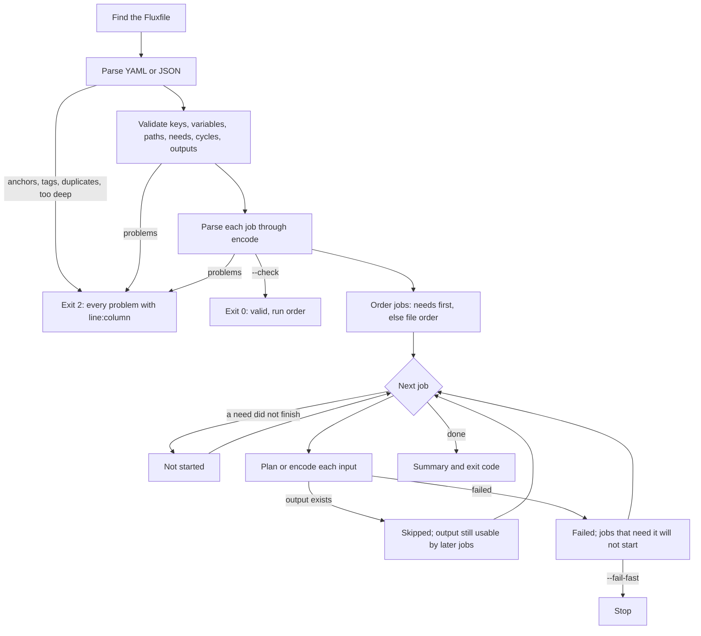

# Fluxfile reference

A Fluxfile is a version-controlled list of encode jobs, written in YAML or JSON, that `flux apply` validates as a whole and then runs in dependency order.

## A first Fluxfile

Save as `Fluxfile.yaml` in the folder that holds your media:

```yaml
# yaml-language-server: $schema=https://gitlab.com/sgkens/fluxencoder/-/raw/main/docs/schema/fluxfile-v1.schema.json
version: 1

defaults:
  quality: high
  audio-codec: aac

jobs:
  master:
    input: raw/take1.mov
    output: out/master.mkv
    codec: hevc

  web:
    input: "@master"          # the output of the job 'master'
    output: out/web.mp4
    codec: h264
    quality: balanced

  trailers:
    input: raw/trailers/      # every media file in the folder
    output: out/trailers/
    preset: web               # a preset from settings.json
```

Then, from that folder (bash or PowerShell):

```bash
flux apply --check      # validate everything; needs no FFmpeg, touches no file
flux apply --dry-run    # probe and plan, show each FFmpeg command
flux apply              # run
flux apply              # run again: finished outputs are skipped
```

## Format

### Top level

| Key | Required | Meaning |
|---|---|---|
| `version` | yes | Format version. Only `1` exists. A newer version is refused with a request to update FluxEncoder. |
| `defaults` | no | Encode options for every job. A job's own value wins. |
| `jobs` | yes | Jobs by name, in file order. At least one. |
| `$schema` | no | Ignored by FluxEncoder; lets JSON editors find the schema. |

### Jobs

Job names use letters, digits, `.`, `_`, and `-`, start with a letter or digit, and are case-insensitive.

| Key | Required | Meaning |
|---|---|---|
| `input` | yes | A file, a folder (its media files), a URL, a `remote://` path, or `"@job"` for that job's outputs. A list for several. |
| `output` | no | A file, or a folder ending in `/`. Default: beside each input, as `encode` does. |
| `needs` | no | Jobs that must finish first. `"@job"` inputs add their job automatically. |
| `preset` | no | A preset from `settings.json`. |
| `description` | no | Free text, ignored. |
| any `encode` option | no | The option's name without dashes: `codec: hevc`, `two-pass: true`, `audio: [jpn, eng]`. |

Values follow the `encode` options exactly, because each job is parsed by the `encode` command itself. Flags take `true` or `false`; `false` cancels a flag set in `defaults`. A list is joined with commas. Unknown keys are errors, with a suggestion for likely typos.

### Values are text

YAML's implicit typing does not apply. `no`, `1:30`, and `010` stay the text you wrote, and each option reads its own value, so `start: 1:30` means 90 seconds and never a number in base 60. Quote values that start with `@`, `*`, `&`, `!`, or `{`, as YAML requires.

### Variables

`${NAME}` is replaced in every value:

| Form | Meaning |
|---|---|
| `${NAME}` | The value of `NAME`. An error if it is unset or empty. |
| `${NAME:-fallback}` | The value of `NAME`, or `fallback` when unset or empty. |
| `$$` | A literal `$`. |

Values come from `--var NAME=VALUE` first, then from environment variables whose names start with `FLUX_`. Other environment variables are never read, so a Fluxfile from elsewhere cannot copy a token such as `GITHUB_TOKEN` into a URL. Substitution happens once; a value containing `${…}` is not expanded again.

```bash
FLUX_MEDIA=/srv/media flux apply --var NAME=episode-01
```

### Paths

Relative paths resolve against the Fluxfile's folder, never the current directory, so a Fluxfile means the same wherever it is run from. Outputs must stay inside that folder; `flux apply --allow-outside` lifts this for Fluxfiles you trust. Symbolic links are not resolved for this check.

### JSON

`Fluxfile.json` has the same structure. Comments and trailing commas are accepted.

```json
{
  "$schema": "https://gitlab.com/sgkens/fluxencoder/-/raw/main/docs/schema/fluxfile-v1.schema.json",
  "version": 1,
  "jobs": {
    "web": { "input": "raw/take1.mov", "output": "out/web.mp4", "quality": "balanced" }
  }
}
```

### Schema

[`schema/fluxfile-v1.schema.json`](schema/fluxfile-v1.schema.json) (JSON Schema draft 2020-12) gives editors validation and completion. A test keeps it identical to what `apply` accepts.

## How apply runs



### Selection

`--job NAME` runs that job and everything it needs, directly or not; repeat it for more.

### Re-running

A job skips outputs that already exist, so `flux apply` after an interruption does only what is missing. `--overwrite` redoes everything selected; a job's own `overwrite`, `rename-existing`, or `skip-existing` replaces the default for that job. A changed setting does not by itself cause a redo: delete the output, or pass `--overwrite`.

### Failures

A failed job stops only the jobs that need it; the others still run unless `--fail-fast`. Exit codes follow `encode`: `0` when everything succeeded or was skipped, `10` when some jobs failed and others succeeded, the failure's own code when all failed, and `2` for any problem in the Fluxfile itself.

### Dry runs

`--dry-run` probes and plans each job. A job whose input is another job's output that does not exist yet is listed as planned once that job has run.

## What a Fluxfile cannot do

A Fluxfile may come from another person or a repository, so `apply` treats it as untrusted input:

| Not allowed | Reason |
|---|---|
| `ffmpeg-arg` | Raw FFmpeg arguments can read or write any file. Use `encode --ffmpeg-arg` for one-off runs. |
| `ffmpeg`, `ffprobe` | Choosing the executable would let a file run any program. Pass `--ffmpeg` to `apply`. |
| Reading environment variables other than `FLUX_*` | Prevents copying secrets into URLs or paths. |
| Writing outside its folder | Prevents overwriting files elsewhere; `--allow-outside` permits it. |
| YAML anchors, aliases, and tags | Alias expansion can exhaust memory; tags request object construction. Neither is needed. |
| `dry-run`, `json`, `quiet`, `verbose`, `no-color`, `fail-fast`, `no-config` | These belong to the `apply` invocation. |

The `encode` defaults in `settings.json` do not apply to Fluxfile jobs; presets named by `preset` and the `security`, `limits`, and `remotes` settings do.
