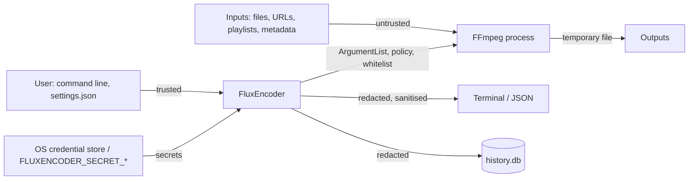

# Security model

FluxEncoder runs FFmpeg on media, paths, and URLs it does not control; this document states what it trusts, what it defends against and how, which controls administrators have, and which risks remain.

## Trust boundaries



- **Trusted:** the person running FluxEncoder, their command line, their `settings.json`, and the FFmpeg binary they installed.
- **Untrusted:** everything inside the media: file and directory names, container metadata, playlists, subtitle text, and FFmpeg's messages about them; and every remote server.
- FluxEncoder never invokes a shell. Every FFmpeg argument is passed through `ProcessStartInfo.ArgumentList`.

## Threats and mitigations

### Hostile file names

| Threat | Mitigation |
|---|---|
| A relative name such as `http:x.mkv`, `concat:a\|b`, or `subfile,…` is read by FFmpeg as a protocol | Local inputs are always passed as absolute paths; verified that FFmpeg otherwise tries to contact the host `x.mkv` |
| A name starting with `-` is read as an option | Inputs follow `-i`; outputs and temporary files are absolute paths |
| Escape sequences or bidirectional overrides in a name rewrite or spoof the terminal | Human output replaces control characters, C1 controls, and bidi overrides with `?`; JSON escapes them |
| A name collides with the input or another batch item | Rejected at planning, case- and symlink-aware |

### Hostile metadata and media

- Titles, tags, and FFmpeg messages are displayed through the same sanitising path as file names and never interpreted as markup or commands.
- A network playlist could list `file:` or other protocols. Every input gets a `-protocol_whitelist` matching its own scheme (HTTPS input: `http,https,tcp,tls,crypto,httpproxy`; local file: `file,crypto,data`).
- Malformed media that exploits a decoder bug in FFmpeg is outside what FluxEncoder can prevent. Keep FFmpeg updated, apply the resource limits below, and in services run FluxEncoder as an unprivileged user in a sandbox or container.

### Remote sources and credentials

- `remote://ALIAS/path` locations hold no secrets in `settings.json`; a URL containing a password is refused there.
- Passwords live in Windows Credential Manager, the macOS Keychain, or the Secret Service, written through standard input only, or come from `FLUXENCODER_SECRET_*` variables set by an external secret provider.
- Building the URL percent-encodes the user, the password, and each path segment, and refuses `.` and `..`, so no character in a password or file name can redirect the request to another host, user, or directory.
- Redaction masks URL passwords, secret query values, RTMP stream keys, `Authorization` headers, and every resolved credential (raw and percent-encoded) in terminal output, JSON, history, and crash output.

### Output integrity

- FFmpeg writes to a hidden temporary file beside the destination. Only output that exists, is non-empty, and stayed under any size limit is moved to the final name, without replacing an existing file unless `--overwrite` was given.
- A run that FluxEncoder stopped (cancellation, stall, run-time limit) is never reported as successful, even though FFmpeg exits 0 after finalising.
- Failed and cancelled outputs are deleted, or kept under their `.partial` name with `--keep-partial`, so they cannot be mistaken for finished files.

### Resource exhaustion

Telemetry (1,800 samples per run) and captured FFmpeg output (last 64 KB) are always bounded. For services, `settings.json` `limits` adds a run-time ceiling, input and output size limits, and thread counts; see [Managed environments](#managed-environments).

### Generated documents

FluxEncoder does not yet write HTML, SVG, Markdown, YAML, or manifests (planned under FMT-E011). When it does, every value from media must be escaped for the target format, YAML must use quoted scalars only, SVG must contain no scripts or external references, and manifests must be parsed without executing or resolving anything they name.

## Raw FFmpeg arguments

`--ffmpeg-arg` passes arguments to FFmpeg exactly as given. FFmpeg options can open any file the user can read or write and contact any network address, so a raw argument bypasses the source policy, the protocol whitelists, and the allowed folders. FluxEncoder warns every time it is used and masks secret-looking values when displaying it.

- In a personal install this is the user's own decision, the same as running FFmpeg directly.
- In a managed or service install, set `FLUXENCODER_MANAGED=1` in the service environment, which disables the option regardless of `settings.json`, or set `security.allowExtraArgs` to `false`.

## Managed environments

```jsonc
// settings.json for a service account (owned by the administrator, not writable by the service)
{
  "security": {
    "allowExtraArgs": false,
    "allowPipes": false,
    "allowDevices": false,
    "allowedSchemes": ["https"],
    "allowedRoots": ["/srv/media"]
  },
  "limits": { "maxRunMinutes": 240, "maxInputMB": 20000, "maxOutputMB": 20000, "threads": 8 },
  "history": { "retentionDays": 30, "maxRuns": 5000 }
}
```

- Point the service at this file with `FLUXENCODER_HOME` and make the `config` folder read-only for the service user; `settings.json` is otherwise user-controlled and its `security` section is only as strong as its file permissions.
- Set `FLUXENCODER_MANAGED=1`.
- Inject remote passwords as `FLUXENCODER_SECRET_REMOTE_<ALIAS>` from the platform's secret manager rather than a desktop keyring.

## Residual risks

- **Credentials in FFmpeg's command line.** A password-protected remote URL is passed to FFmpeg as an argument. Other processes of the same user, and on Linux other users unless `/proc` is mounted with `hidepid`, can read process arguments while FFmpeg runs. Prefer key-based SFTP authentication or short-lived token URLs where the remote supports them.
- **Unrecognisable secrets.** Redaction masks known shapes and registered values; a secret pasted into a file name or an unrecognised option value can still appear in output.
- **FFmpeg itself.** Decoder vulnerabilities, and whatever the installed FFmpeg build enables, are outside FluxEncoder's control.
- **Windows Credential Manager support** is implemented but not yet verified on Windows.
